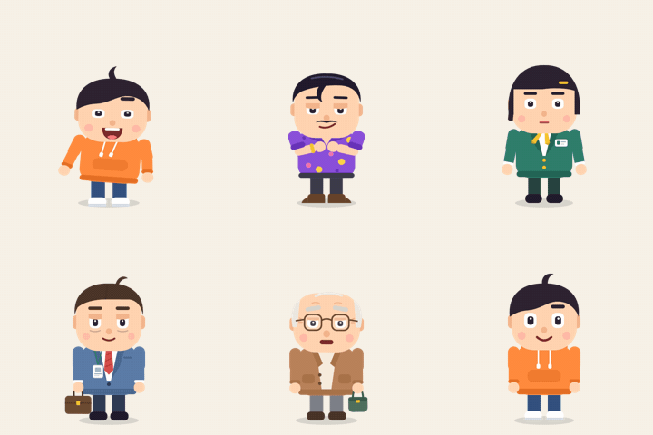

# IP Motion Characters · 会动的 IP 角色

一个 [Claude Skill](https://docs.claude.com/en/docs/agents-and-tools/agent-skills/overview)：用一句话描述角色，让 AI 做出**灵动、Q 弹、有冲击力**的角色动画，
并且每一步都有确认关口和自动质检。


<p>


</p>



## 它能做什么

- **31 个动作开箱即用**：idle、跳跃、欢呼、难过、思考、说话、惊吓、看手机、走路、走过画面、派对舞、甩胯舞、机器人舞、太空步、dab、叉腰、比耶、比心、晕倒……
- **性格决定节奏**：每个角色一份「运动性格档案」（体重 / 能量 / 稳定性 / 风格）。同一个动作模板，年轻人蹦着走，老人慢慢挪，骗子蹑手蹑脚。
- **冲击有连锁反应**：撞击定格、果冻回弹、头晚一拍、松脱物飞散、表情撞歪、扬尘、画面震动。
- **自动次级运动**：头发、领带、包的弹簧；前臂惯性；挂件保持下垂；身体与头的果冻层。
- **一句话串成片**：`seq@walk_across+dance_x2+dab+walk_across@l`，接缝自动过渡，位置自动衔接。
- **口型驱动**：读 [Rhubarb Lip Sync](https://github.com/DanielSWolf/rhubarb-lip-sync) 的输出，自动加重音点头、停顿眨眼。
- **质量护栏**：`lint`（动画硬规则数值检查）、剪影对比（只看动作能否分出角色）、视觉回归（防止改坏旧动作）。

自带 5 个示例角色（反诈系列：年轻人、骗子、老年人、上班族、银行职员），可以照着做自己的系列。

## 安装

**Claude Code**

```bash
git clone https://github.com/realjian-JZ/ip-motion-characters ~/.claude/skills/ip-motion-characters
```

**Claude.ai**：在仓库页点 Code → Download ZIP 下载，在 设置 → 功能 → Skills 上传。

**环境**：Python 3.9+、Google Chrome 或 Edge、ffmpeg（在 PATH 上）、git。

```bash
pip install -r requirements.txt
```

## 用法

对 Claude 说：

- 「做一个会动的外卖小哥，性格急躁，招牌动作是看表和小跑」
- 「让骗子走进来，跳一段舞，然后晕倒」
- 「给老年人加一个拍大腿恍然大悟的动作」

Claude 会按 `SKILL.md` 的流程走：角色卡 → 概念图（**关口 1：你确认造型**）→ 部件拆分 → 动作 → lint → 渲染 → 自检（**关口 2：你确认节奏**）→ 导出 → 把这次的修正写回 skill。

手动运行（在复制出来的工作目录里）：

```bash
python -m http.server 8765                         # 打开 http://localhost:8765/preview.html 交互预览
python scripts/lint.py                             # 硬规则检查
python scripts/render.py --char young --motion all # 渲染 → out/young/
python scripts/review.py                           # 总览页 out/index.html
```

## 目录

```
SKILL.md          流程、确认关口、硬规则（Claude 读这个）
references/       造型规范、部件卡、运动性格档案、曲线与冲击 token、状态名、口型、质检清单
engine/           ipm.js 引擎 · motions.js 动作模板 · lint.js
characters/       5 个示例角色（SVG 部件 + 性格档案）
scripts/          render · lint · regress · silhouette · review · showcase · package
CHANGELOG.md      每条规则从哪个问题来、怎么验证
```

## 说明

- 动画规律受多邻国式角色动画启发；**角色、造型和代码均为原创，与多邻国（Duolingo）无关**。
- 示例角色是几何 SVG，正式项目建议先用生图工具出概念图、确认后再拆部件（流程见 SKILL.md）。

## License

MIT
